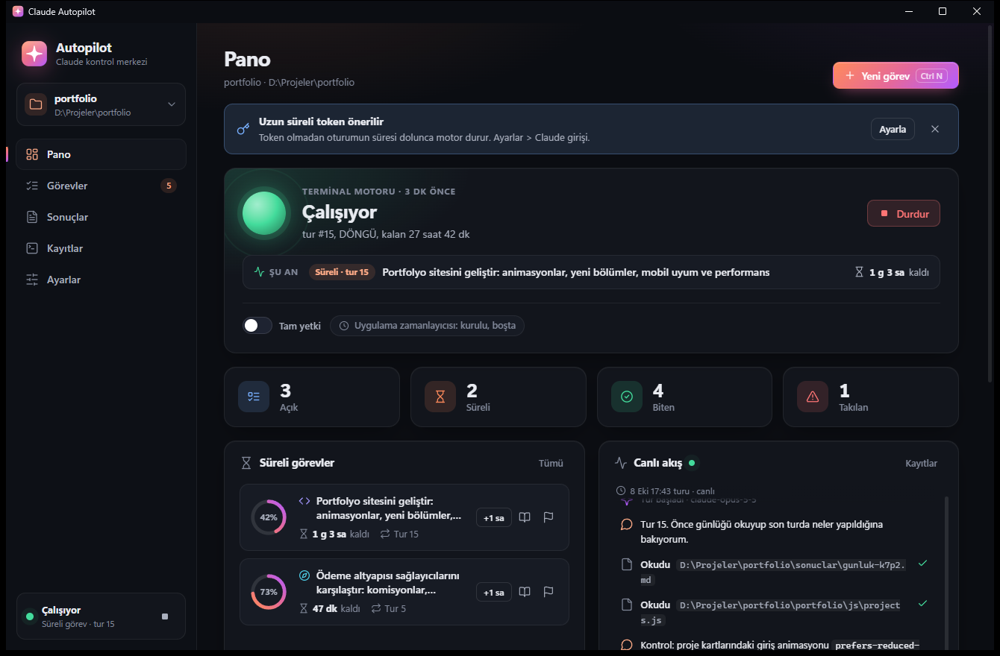
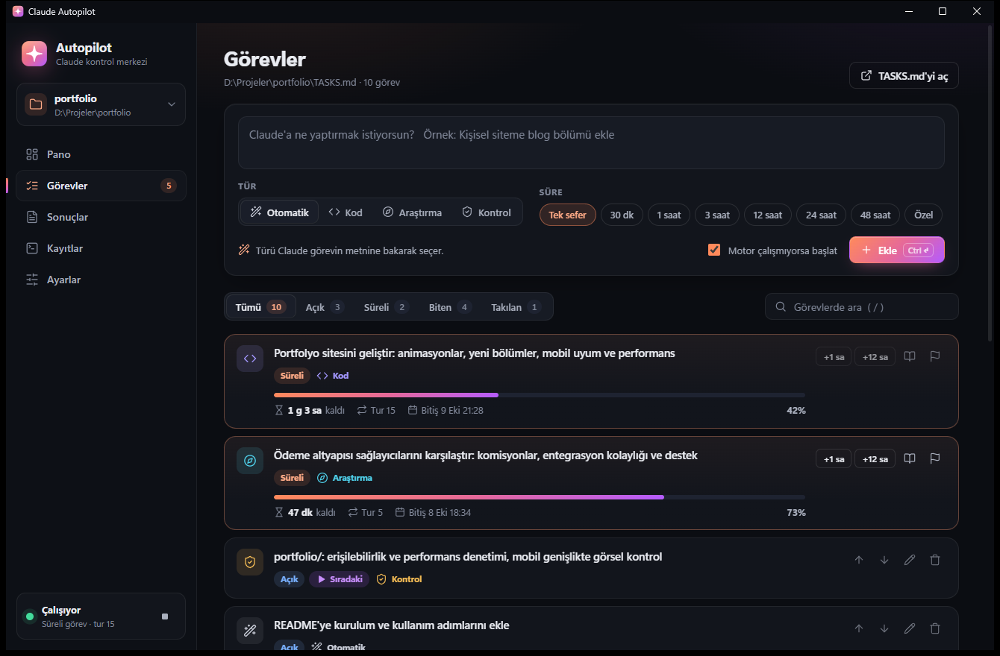
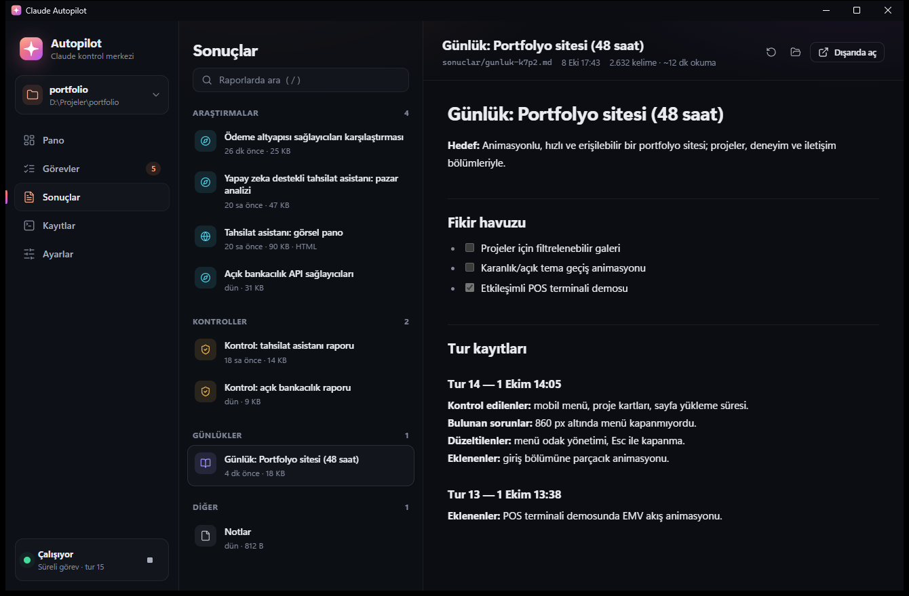

# Claude Autopilot

A Windows desktop app that keeps [Claude Code](https://docs.claude.com/en/docs/claude-code/overview) working through your task list unattended.
Write tasks in a plain `TASKS.md`, pick a type (code, research or review), and let it run.
Give a task a time budget and it won't stop at "done": it keeps reviewing, fixing and
adding improvements until the time is up.



## Features

- **Task queue:** code, research and review tasks with priorities
- **Time-boxed tasks:** review → fix → improve rounds with a countdown, plus a journal
- **Auto-resume:** waits for the usage-limit reset and picks up where it left off
- **Live feed:** every file read, command and search as it happens
- **Reports:** read research and review results inside the app
- **Tray notifications:** when tasks finish, get stuck or hit a limit
- **One-click installer:** for other Windows PCs

| Tasks | Reports |
|---|---|
|  |  |

The UI and the task syntax are in Turkish.

## How it works

1. `TASKS.md` in your project folder is the queue. One line per task, for example
   `- [ ] [kod] Add a /health endpoint` or `- [ ] [araştır] [süre: 3 saat] Open banking APIs in Turkey`.
2. `engine/sira.ps1` picks what runs next: a one-off task, the next round of a time-boxed task, or its closing round.
   It owns the deadline, so a time-boxed task can't be closed early. If Claude marks one as done too soon, the engine reopens it.
3. `engine/autopilot.ps1` runs `claude -p` once per round with `engine/kurallar.md` as the instructions.
   It streams every step to `.autopilot/logs/`, and sleeps until the limit resets when it hits one.
4. The desktop app (WPF + WebView2) reads those files, starts and stops the engine, and shows everything live.

Research results go to `sonuclar/`. Each time-boxed task keeps a journal there (`sonuclar/gunluk-<id>.md`) that carries its memory between rounds.

## Requirements

- Windows 10 or 11 (64-bit)
- [Claude Code](https://docs.claude.com/en/docs/claude-code/setup) with a Pro or Max subscription
- PowerShell 7, Git for Windows, Microsoft Edge WebView2 Runtime

The installer checks for these and offers to install whatever is missing.

## Install

1. Build the installer package (needs the .NET 10 SDK):
   ```powershell
   pwsh -File paketle.ps1
   ```
   This creates `kurulum/ClaudeAutopilot-Kurulum.zip`. It's self-contained, so the target PC doesn't need .NET.
2. On the target PC, extract the zip and double-click `Kur.cmd`. No admin rights needed.
3. In the app, open **Ayarlar → Claude girişi → Terminali aç**. This runs `claude setup-token`; paste the token it prints back into the app.
4. Pick a project folder and add your first task.

To uninstall: Windows Settings → Apps → Claude Autopilot. Your project folders are left untouched.

## Command line

The engine also works from a terminal through the `ap` command in `engine/`:

```text
ap kod "add a /health endpoint"          one-off coding task
ap ara 3s "open banking APIs in Turkey"  research for 3 hours
ap kontrol "src/Payments idempotency"    review something
ap durum                                 status and time left
ap uzat 12s / ap bitir                   extend / finish time-boxed tasks
ap uygulama                              open the desktop app
```

## Build from source

```powershell
dotnet build                  # debug build
pwsh -File publish.ps1        # release build into dist/
```

- `ClaudeAutopilot.exe --demo` opens the app with sample data.
- `--view <name>` opens a specific screen (`dashboard`, `tasks`, `results`, `logs`, `settings`).
- `--tray` starts it hidden in the tray.
- To work on the UI without the app, serve `web/` with any static server. It falls back to the sample data in `web/js/mock.js`.

```text
engine/      PowerShell engine: ap, autopilot.ps1 (loop), sira.ps1 (scheduler), kurallar.md (rules for Claude)
Core/        TASKS.md parsing, engine control, reports, logs, file watching, notifications
web/         UI (HTML, CSS, vanilla JS)
installer/   Kur.cmd, kur.ps1, kaldir.ps1 (installer and uninstaller)
Api.cs       commands the UI can call
Bridge.cs    WebView2 messaging
AppHost.cs   settings, tray icon, watchers
```

## Security notes

- The app only reads and writes inside project folders you've added. Paths that escape them are rejected.
- Markdown reports are rendered with raw HTML disabled, and the UI runs under a strict Content Security Policy,
  since research content comes from the web.
- Only documents, images and http(s) links can be opened from the app. Executables are never launched.
- The long-lived token is stored only in your Windows user environment (`CLAUDE_CODE_OAUTH_TOKEN`).
- **Full access mode** (`--dangerously-skip-permissions`) is off by default. Turn it on only for folders you trust and back up with git.

> Unofficial project, not affiliated with Anthropic.
